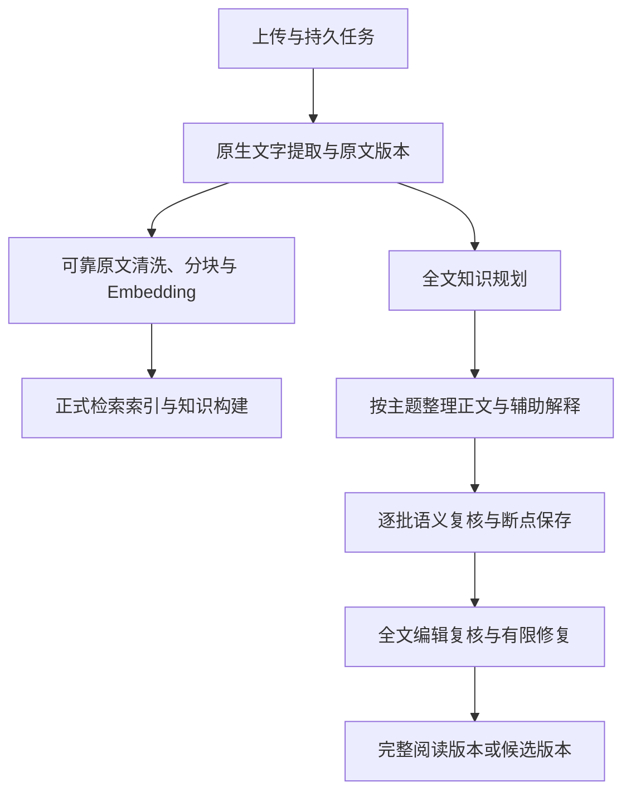

# 资料上传、解析与 AI 润色流程

当前完整学习笔记策略说明见 [资料学习笔记](material-learning-notes.md)。

上传后先保存原文件、提取原生文字并保存不可变原文版本，再独立进行可靠原文索引与阅读笔记生成。检索/知识证据使用原文，阅读版本可编辑、可重新生成；后台来源映射不在正文逐段展示。

详细的模型配置、来源缺口、版本保护和验证结果以新说明为准；此前逐块改写的 v1 说明已被替代。
