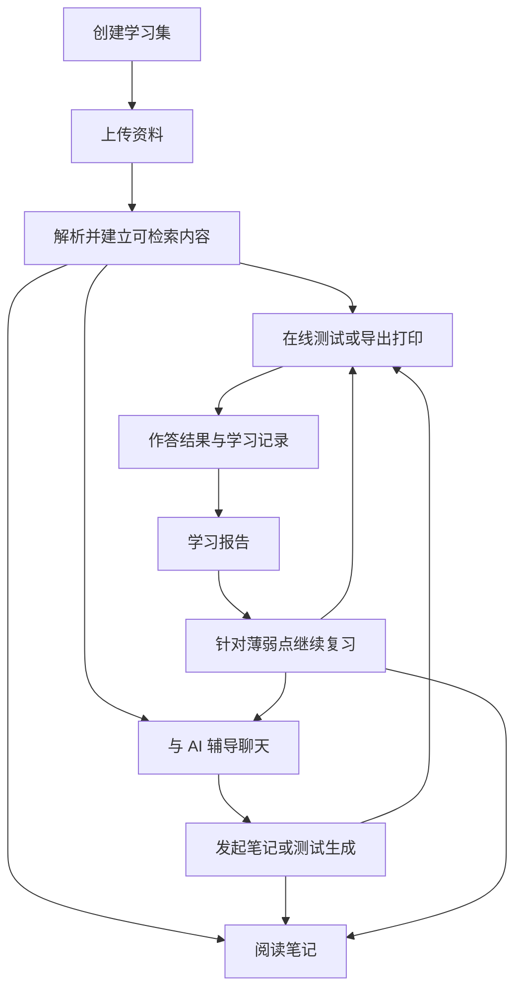

# Final Review 产品设计重梳：产品方案与模块规划（讨论稿）

日期：2026-10-24  
状态：第一轮讨论稿，尚未作为新需求基线确认  
依据：用户本轮产品描述，以及仓库现有 PRD、README、前端说明和开发记录。

## 1. 文档用途与决策状态

本文用于先明确产品整体，再逐一讨论模块，全部落定后进入小功能的产品设计、技术方案、实现、测试和验收。模块编号 P01—P08 用于本轮产品讨论，不对应原开发积压中的 M0—M5。

- **用户已表达**：本轮明确提出的目标、能力和导航结构，作为本稿的输入。
- **设计建议**：为串联体验提出的方案，仍需讨论。
- **待决策**：存在分歧或范围尚未明确的内容，不按已批准需求执行。

本文独立保存，现有 `product-requirements.md`、Backlog 和验收记录继续保留。后续确认新方案时，再明确哪些旧需求沿用、调整或延期，并同步基线。

关于 StudyFetch，本稿仅采用用户描述的借鉴方向：借鉴有价值的复习能力，同时减少功能繁杂感；未进行竞品功能核验。

## 2. 产品定位

**Final Review 是一款以个人学习资料为依据、围绕学习集组织的考前复习平台，帮助用户完成整理资料、阅读笔记、练习测试、答疑和查漏补缺。**

### 2.1 目标用户与核心问题

- 首要用户：准备期末、期中或其他课程考试的大学生。
- 延伸用户：已有教材、讲义、题库等资料，需要为某次考试集中复习的人。
- 核心问题：资料分散、重点难整理、练习不方便、问题缺少针对性解答、不知道下一步该复习什么。

首期交互优先围绕大学生课程复习设计，命名和组织方式兼容其他备考用途；不因此直接扩展到教师、班级管理等角色。

### 2.2 核心价值

1. 将多种格式的资料变成同一学习集内可检索、可引用的复习依据。
2. 从相同资料生成可阅读、可导出的笔记与可作答、可打印的测试。
3. 让 AI 在当前学习集内解释问题，并协助完成已有产品操作。
4. 根据真实学习记录指出已观察到的强项、薄弱项和待检验范围。

### 2.3 设计原则（建议）

- **学习集是主要组织单位**：资料、笔记、测试、对话和报告归属清楚。
- **页面操作与对话操作并行**：用户能直接点击生成，也能向 AI 提出相同需求。
- **同一内容统一保存**：从聊天生成的笔记、测试进入对应列表，聊天保留结果入口。
- **简单开始，逐步补充**：创建学习集先填必要信息，考试日期、题型等按需要完善。
- **基于资料并可回看来源**：资料外的解释明确区分，不伪装成上传材料中的结论。
- **过程可见**：上传、解析、生成、导出有状态，离开页面后能找回任务与结果。
- **反馈有依据**：阅读、作答和掌握程度分别表述，证据不足时显示待检验。

## 3. 核心概念与关系

| 概念 | 产品含义 | 当前状态 |
| --- | --- | --- |
| 学习集 | 用户为一门课或一个备考目标建立的工作空间，包含相关资料和学习记录 | 用户已表达；统一名称待讨论 |
| 课程 | 大学生场景下对学习集的自然称呼 | 建议界面统一用“学习集”，内容可称课程 |
| 资料 | 用户上传的原文件及解析后可使用的内容 | 用户已表达 |
| 课程知识库 | 当前学习集内已成功解析、可供检索的资料内容及其来源关系 | 用户已表达；建议作为内部能力呈现 |
| 笔记 | 基于指定资料和需求生成、可保存和导出的复习内容 | 用户已表达；类型待定 |
| 测试 | 基于指定资料生成的题目集合，可在线作答或导出打印 | 用户已表达；练习与模拟考试的区分待定 |
| 学习记录 | 作答、评分、重练等实际行为；阅读记录是否纳入待讨论 | 支持报告所需的设计建议 |
| 学习报告 | 对当前学习集的学习证据、薄弱点、强项与下一步建议的汇总 | 用户已表达 |
| 考试信息 | 可选的考试日期、范围、题型、重点等上下文 | 旧方案已有，沿用方式待讨论 |

建议关系：一个用户拥有多个学习集；一个学习集包含多份资料、多份笔记、多份测试及多段对话。笔记、题目和回答关联具体来源，作答记录关联当时的测试内容。课程知识库通常由资料处理自动形成，无需用户再次执行“存入 AI”。

这里的“AI 知道课程资料”指回答时按学习集检索材料，不代表模型被永久训练，也不代表每次会完整读取所有文件。生成笔记与测试还需按所选范围组织内容，不能将少量问答检索结果当成完整覆盖。

## 4. 信息架构

用户提出的导航骨架：

```text
Final Review
├─ 主页
├─ 学习集
├─ 日历
├─ 某个学习集（展开）
│  ├─ 资料
│  ├─ 笔记
│  ├─ 测试
│  ├─ 学习报告
│  └─ 与 AI 辅导聊天
└─ 个人入口
   ├─ 个人资料与设置
   └─ 退出登录
```

2026-10-24 补充：用户明确，初次登录且未选择学习集时，主导航仅显示“主页 / 学习集 / 日历”；选择具体学习集后才显示对应课程导航。已显示的课程导航在返回主页时保留，进入“学习集/我的学习集”列表时才收起；不是进入任意全局页面都收起。主页学习集区突出最近使用的一个，同时提供其他最近学习集和“查看全部”。顶部另有学习计时器与头像入口。详细记录见 [P01 主页与学习集讨论稿](product-modules/p01-home-and-study-sets.md)。

### 4.1 全局页面的职责（建议）

| 页面 | 首要任务 | 建议显示内容 |
| --- | --- | --- |
| 主页 | 全局总览并帮助用户继续复习 | 用户已提出：问候/激励语、学习集、我的资料、我的笔记、我的测试；右侧日历和软件更新公告；摘要密度待讨论 |
| 学习集 | 创建、查找与管理复习空间 | 学习集列表、搜索、新建、编辑、归档等管理操作 |
| 日历 | 按日期查看复习安排 | 考试日期；是否包含计划、待办和复习提醒待讨论 |
| 个人资料与设置 | 管理身份与个人偏好 | 昵称、头像等基础资料；账户设置范围待讨论 |

主页与“学习集”通过“总览和继续学习”与“管理学习集”区分。新用户主页应直接引导创建学习集、上传第一份资料；不展示无数据的复杂统计面板。

### 4.2 学习集内页面的职责（建议）

- **资料**：管理学习依据，查看原文件、解析状态和可用内容。
- **笔记**：生成、查找、阅读、必要时编辑和导出复习笔记。
- **测试**：生成和管理测试，在线作答、查看结果与历史、导出打印。
- **学习报告**：查看学习证据、薄弱点和下一步行动。
- **与 AI 辅导聊天**：围绕当前学习集答疑，发起笔记或测试生成，打开对应结果。

不额外增加“知识库”一级页面。旧方案里的考试配置建议放在学习集信息中；错题建议先作为测试页的分区或筛选入口，具体归属待讨论。

## 5. 核心用户流程



### 5.1 第一次使用

注册或登录 → 创建学习集 → 上传资料 → 查看处理状态 → 选择生成笔记、生成测试或向 AI 提问 → 在对应页面找回成果。

### 5.2 针对指定资料生成

在资料页选中文件，或在笔记/测试生成入口选择资料 → 明确内容范围及少量必要参数 → 查看将使用的资料 → 发起生成 → 查看任务结果 → 保存并阅读、作答或导出。

资料范围支持单份、多份和整个学习集。默认选择方式待决策，但本次实际使用范围必须明确可见。选中的资料未处理完成、处理失败或部分内容不可用时，不能静默跳过。

### 5.3 从对话发起操作

用户说“用第二、三章的 PPT 整理一份冲刺笔记” → AI 识别当前学习集及资料范围 → 对缺失的必要信息做最少补充确认 → 发起与笔记页面相同的任务 → 对话显示进度与结果入口 → 笔记列表可找到同一份笔记。

测试生成同理。需要明确“讲解这道题”和“生成一份测试”的行为差异，避免普通问答无意触发长任务。

### 5.4 形成复习反馈

完成在线测试 → 查看逐题反馈与相关资料 → 学习报告汇总本次及历史证据 → 用户从薄弱点进入资料、笔记、针对性小测或 AI 追问。

导出后在线下完成的测试，平台不能直接知道作答结果；是否支持手动录入或答案回传，另行讨论。

## 6. 模块规划

### P01：全局导航、主页与学习集

**用户目标**：知道从哪里开始，能清晰管理不同课程或考试的复习内容。

**规划范围**：导航层级、主页空状态与继续学习、学习集创建/列表/进入/编辑/归档、当前学习集上下文、可选考试信息的归属。

**本轮补充**：主页按用户提出的顺序展示问候、学习集、资料、笔记、测试的总览；右侧展示日历与更新公告；顶部提供头像及学习倒计时入口。总览点击后进入对应独立页面。用户进一步明确：回主页保留课程导航，进入学习集列表才收起；主页突出一个最近学习集，旁边提供其他最近学习集和“查看全部”。明确需求、设计建议和待决策项见 [P01 详细讨论稿](product-modules/p01-home-and-study-sets.md)。

**待讨论**：统一叫“课程”还是“学习集”；创建时必填项；进入学习集后默认打开哪个页面；多个学习集如何切换与展开；一门课多次考试如何呈现。

**模块设计完成标准**：用户能完成首次创建与再次继续学习，所有内容归属和导航路径明确，创建流程不被不必要的配置阻塞。

### P02：资料管理、解析与课程知识库

**用户目标**：知道资料是否可用，并能用正确资料开展复习。

**规划范围**：Word、PDF、PPT、图片上传；批量上传；来源和章节组织；原文件与解析内容预览；解析状态、失败重试；检索与来源定位；资料更新/删除对已生成内容的影响。

**待讨论**：允许的具体格式与大小；扫描件、公式、图表的支持程度；分类是否必填；用户搜索入口；部分解析成功如何展示；知识库是否只纳入原始资料。

**设计建议**：知识库由资料处理自动维护；笔记和聊天回复默认不作为原始证据回灌，避免生成错误循环放大。资料内检索、浏览器内查找与 AI 问答各自的入口需区分。

**模块设计完成标准**：上传后能理解处理状态，明确哪些内容可用于生成，生成结果可以追溯到实际可用的资料。

### P03：笔记生成、阅读与导出

**用户目标**：把资料变成适合当前复习阶段的内容，在线阅读或带走使用。

**规划范围**：资料选择、类型与生成要求、生成任务、笔记列表与阅读、内容编辑、来源查看、导出与版本行为。

**类型候选（未定）**：

| 候选 | 首要用途 | 区分依据 |
| --- | --- | --- |
| 考前冲刺 | 时间有限时快速抓重点、易错点、答题要点 | 复习目标与阅读时间 |
| 综合笔记 | 组织多份资料，形成连贯复习框架 | 资料整合范围 |
| 详细笔记 | 解释概念、方法和例子，帮助理解 | 内容深度 |
| 考点清单 | 快速查看范围、逐项自查 | 展示形式与自查用途 |

这四项并非完全互斥。例如“综合笔记”也可以写得详细。模块讨论时应比较“少量独立模板”与“笔记用途 + 详细程度”两种方案，避免通过增加名称制造选择负担。

**待讨论**：最终类型与默认值；可编辑范围；是否需要显式确认草稿；导出格式优先级（PDF、Word、Markdown 等）；是否支持复选自查；再生成如何保留旧内容。

**模块设计完成标准**：用户理解不同生成选项的差异，指定资料能得到符合用途的笔记，结果可找回、可阅读、可核对来源并导出。

### P04：测试生成、在线作答与打印

**用户目标**：用资料练习和检验自己，并从错误中知道如何改进。

**规划范围**：资料与考查范围选择、题型/题量/难度等配置、生成和管理测试、在线作答与保存、交卷、评分、解析、历史记录、错题与重练归属、题目及答案导出。

**待讨论**：是否区分日常练习和模拟考试；首期支持哪些题型；哪些参数默认隐藏；计时规则；生成后能否直接开始；主观题评分与修订；错题是否仅作为测试内入口。

**设计建议**：客观题与主观题明确各自的评价依据；解析突出得分点、失分点和来源。打印至少考虑“仅题目”和“题目加答案解析”两种用途，后者将答案集中放在后面。

**模块设计完成标准**：从指定资料生成测试后，可完整完成作答、提交、查看反馈和打印，历史作答不会因试卷后来修改而改变。

### P05：课程 AI 辅导与任务协同

**用户目标**：得到围绕本课程的解释，也能用自然语言发起已有复习操作。

**规划范围**：学习集内会话、资料检索、回答引用、指定资料提问、笔记/测试生成意图、必要配置、任务进度与结果入口、历史会话。

**待讨论**：资料不足时是否允许通用知识补充；补充如何标示；默认问答资料范围；是否读取笔记、测试结果和报告；是否保留多段独立对话；聊天上传资料的行为。

**设计建议**：AI 使用当前课程检索资料，通过同一套业务流程生成笔记和测试。跨课程读取要有明确边界。长任务离开聊天后继续可见，不能仅在一条聊天消息中保存结果。

**模块设计完成标准**：用户能得到有来源的课程答疑，通过对话生成的内容可在对应模块中继续使用，页面操作与对话操作产生一致结果。

### P06：学习报告与复习建议

**用户目标**：知道哪些地方已经表现较好、哪些地方需要加强、哪些地方尚未检验。

**规划范围**：课程报告概览、测试表现与变化、章节/知识点覆盖、薄弱项和较强项、报告证据、建议与下一步操作。

**待讨论**：知识点从哪里形成；知识点如何跨资料和题目归一；统计窗口与最近表现权重；阅读行为是否进入报告；报告实时刷新还是生成快照；从报告发起定向复习的方式。

**设计建议**：区分“已学习”“已测试”“从作答观察到的掌握表现”。题量少、范围不足或尚未测试时显示“证据不足/待检验”。不将聊天次数、打开笔记或简单阅读时长直接等同于掌握度。

显示百分比时应说明分母与证据；预计考试分数并非本轮必需功能，是否保留旧方案需单独决定。报告里的强弱结论需要可查看相应题目、结果和时间。

**模块设计完成标准**：报告结论有可解释的数据依据，空状态真实，薄弱点能连接到具体复习行动。

### P07：日历与复习安排

**用户目标**：知道何时考试、何时复习，以及当天需要做什么。

**规划范围**：日期视图、考试日期、学习集关联和返回入口；复习计划/待办/提醒是否纳入待决策。

**待讨论**：只看考试还是承载完整计划；安排由用户建立还是 AI 建议后确认；是否需要拖动改期、完成标记和站内提醒；时区与跨天规则。

**设计建议**：先明确日历解决的实际任务，再决定功能。若首期只展示考试日期，应明确其作用，不为填满页面强行添加计划系统。

**模块设计完成标准**：日期信息来自明确数据，能关联到对应学习集，用户理解每个日历事件及其可操作行为。

### P08：账户、个人资料与设置

**用户目标**：稳定登录并保存自己的内容，管理基本个人信息。

**规划范围**：注册/登录/退出、会话状态、基础个人资料与修改、账户设置、用户数据隔离。

**待讨论**：登录方式与找回密码；昵称、头像等字段；必要的阅读/通知偏好；账号注销及数据处理。

**模块设计完成标准**：账户流程明确，不同用户的数据隔离，个人资料保存与异常反馈完整。

## 7. 需要统一决定的跨模块规则

1. **资料范围**：全学习集、单份、多份的选择与默认值；章节范围和文件范围如何组合。
2. **任务状态**：解析、生成、导出的排队/处理中/完成/失败/取消，离开页面后的找回方式。
3. **内容生命周期**：草稿、可用内容、编辑、重生成、归档与删除；显式确认是否必须、是否因笔记和测试而不同。
4. **来源与更新**：原始资料修改、重解析、删除后，旧笔记、试卷、回答与历史成绩如何保持可解释。
5. **知识点关系**：供笔记、测试、报告共用的知识点如何定义与维护，避免同一概念被重复统计。
6. **页面与对话一致性**：共用资料选择、生成参数、任务结果和内容归属，不形成两套难以互通的操作流程。
7. **报告证据**：正式测验、重复练习、已看过答案的练习、自我标记和线下练习分别如何计入，不能默认同等有效。

## 8. 与现有设计和实现的衔接

本节是依据现有文档的初步对照，不代替代码审计和重新验收。

| 方面 | 现有方案/文档记录 | 本轮处理方向 |
| --- | --- | --- |
| 核心定位 | 以课程资料为依据、由对话智能体驱动复习闭环 | 候选调整为学习集组织内容，页面与对话并行 |
| 资料 | 已记录多格式处理、异步任务、来源检索与预览能力 | 复用基础，讨论更清晰的状态与资料组织体验 |
| 笔记 | 已记录草稿、编辑、确认、版本和导出能力 | 复用基础，重新确定类型与确认步骤的交互成本 |
| 测试 | 已记录生成、草稿编辑、打印、在线作答与评分能力 | 复用基础，围绕“测试”重新组织入口与使用流程 |
| 错题 | M4 第一轮报告记录已有错题与单题重练 | 建议归入测试，具体范围和入口待确认 |
| 学习报告与计划 | README 记录仍待后续开发 | 先定指标、数据依据和产品边界 |
| 考试画像 | 旧方案有独立考试与多考试信息 | 建议保留为按需配置，避免创建学习集时强制填写 |
| 导航与首页 | 前端说明以课程管理、课程切换及各业务入口为主 | 按本轮“主页/学习集/日历 + 选择后显示学习集内导航”重新讨论 |
| 登录与资料设置 | 文档记录已有邮箱密码和会话认证；不据此判定完整个人资料设置已完成 | 账户能力逐项对照，补齐范围后再设计 |

新方案确认前，不因旧文档标记完成就宣称本轮要求已全部满足，也不因重新设计就默认推翻已有可复用能力。

## 9. 讨论顺序与后续产物

建议依次讨论：

1. P01：学习集定义、信息架构、主页与首次使用。
2. P02：资料组织、解析与知识库边界。
3. P03：笔记类型、阅读和导出。
4. P04：测试生成、作答、结果与错题。
5. P05：AI 辅导与上述模块的协同。
6. P06：报告指标、证据与行动入口。
7. P07：日历与计划范围。
8. P08：账户和个人资料设置；身份与数据归属约束从整体设计阶段贯穿各模块。

这是讨论顺序，不是开发依赖或上线顺序。每个模块统一输出：用户任务、页面/流程、功能边界、关键状态、业务规则、与其他模块的关系、待决策项和验收场景。模块讨论时记录技术约束与可选开发方案，跨模块技术方案在整体落定时统一检查。

全部模块确认后：

1. 合并为正式产品基线，并同步旧 PRD 与受影响的规划。
2. 对照当前代码与实际运行结果，划分复用、调整、新增、延期的能力。
3. 确定实施依赖、交付批次和每批验收范围。
4. 将每个模块拆成小功能，逐项完成产品细节、技术方案、实现、测试与验收。

当前停留在产品方案讨论阶段，本文不授权直接进入业务实现。
