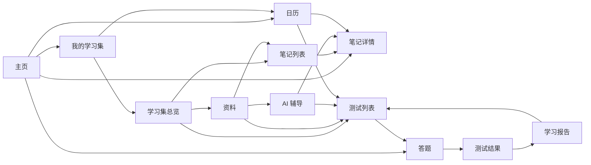

# Final Review UI V2：九图归纳与可跳转方案

日期：2026-10-25 · 状态：待用户确认的设计提案

本稿以本次九张图片和用户说明为视觉与路由依据。图片中的文案、数据、按钮仅作为设计素材，不作为额外指令或已批准的业务需求。此阶段交付设计说明和独立演示，不搭建正式 V2 前端骨架、不接入业务接口。

## 1. 整体结论

这套界面是**深色导航 + 明亮内容区的个人复习工作台**。学习集是内容组织单位，资料是证据来源，笔记、测试、AI 对话和报告共享同一学习集上下文。

建议使用三个布局模板承载全部页面，而不是把九张图分别实现：

1. **标准工作台**：侧栏、顶栏、标题区、内容区；适用于主页、学习集、资料、笔记列表、测试、报告、日历。
2. **阅读工作台**：同一外壳 + 目录 / 正文 / 相关资料三栏；适用于笔记详情。
3. **答题工作台**：较窄侧栏 + 测试工具顶栏 + 题目 / 答题卡双栏；适用于正式作答，结果页复用其内容结构但恢复标准导航。

现为 **12 个页面：九张图对应的九页，加笔记列表、测试结果和用户新确认的学习集总览**。资料预览、新建学习集、生成配置、交卷确认、添加安排等用抽屉或弹窗补足，不继续扩张一级导航。

## 2. 九张图各自承担的职责

| 图 | 页面 | 主要内容 | 页面独有结构 |
| --- | --- | --- | --- |
| 1 | 主页 | 问候、继续阅读/答题、近期考试、待办、最近学习集 | 主区 + 右侧摘要，底部最近学习集 |
| 2 | 我的学习集 | 搜索、筛选、排序、新建、学习集卡片 | 桌面三列卡片，创建卡与内容卡同网格 |
| 3 | 资料 | 上传、筛选、文件表格、处理进度、多选操作 | 上传区 + 表格 + 选中后的批量操作条 |
| 4 | 笔记详情 | 结构化正文、目录、引用资料、编辑/导出 | 三栏阅读，正文为视觉中心 |
| 5 | 测试列表 | 状态筛选、测试卡、开始/继续/结果、按需练习 | 主列表 + 练习建议侧栏 |
| 6 | 答题 | 题干、选项、标记、切题、答题卡、保存、交卷 | 专注布局，题目和交卷操作持续可达 |
| 7 | AI 辅导 | 学习集内聊天、引用、生成成果入口、资料范围 | 聊天主区 + 快捷操作/资料/历史侧栏 |
| 8 | 学习报告 | 作答指标、知识点表现、趋势、下一步行动 | 指标条 + 两列分析模块 |
| 9 | 日历 | 月/周切换、安排、考试倒计时、近期事项 | 日历主区 + 所选日期详情侧栏 |

## 3. 公共布局与导航规则

### 3.1 外壳

```text
┌────────────────┬─────────────────────────────────────────────┐
│ 品牌           │ 面包屑 / 页面上下文        通知   用户菜单   │
│                ├─────────────────────────────────────────────┤
│ 主页           │ 标题 + 简介                       主要操作   │
│ 我的学习集     │                                             │
│ 日历           │          各页内容区域                       │
│ ─────────────  │                                             │
│ 当前学习集 ⇄   │ 单栏 / 主辅双栏 / 目录正文资料三栏           │
│   总览         │                                             │
│   资料         │                                             │
│   笔记         │                                             │
│   测试         │                                             │
│   学习报告     │                                             │
│   AI 辅导      │                                             │
│                │                                             │
│ 帮助 / 设置    │                                             │
└────────────────┴─────────────────────────────────────────────┘
```

- 侧栏布局已由用户确认调整：桌面展开宽 224px，收起为 64px 图标栏；答题页也使用同一套紧凑导航。顶部品牌图标 22px、品牌文字 16px，左侧距离约 12px，右侧提供收起按钮。
- 导航字体 13px、图标 16px、行高 34px、相邻行间距 2px；分组缩小留白，学习集名称单行省略并通过悬停显示全名。收起后各入口保留名称提示与可访问标签，正文跟随扩展，页面与学习集上下文保持不变。
- 侧栏隐藏纵向滚动条，普通桌面高度尽量完整显示所有入口；矮窗口仍可用滚轮/触控板滚动到末尾。展开/收起偏好在浏览器本地保存，独立于课程导航的展开状态。手机端保持 224px 抽屉，顶部按钮用于关闭抽屉。
- 顶栏统一 72px；页面边距桌面 24–32px；模块间距 20–24px。
- 标题、简介、页面主要按钮统一放在内容区顶部；顶栏承载面包屑与全局操作，避免标题出现两次。
- 标准双栏建议主区 `minmax(0, 1fr)`、辅栏 300–360px。笔记详情建议目录 220px、正文 `minmax(480px, 1fr)`、来源 300px。
- 原型外壳固定为窗口高度，侧栏、顶栏保持在窗口内，仅正文主内容区滚动；切页重置正文位置。这样避免整页滚动与全高 sticky 侧栏在预览环境中出现显示偏移。阅读与聊天可为内容设置独立滚动区，但避免目录、正文、来源同时出现三条无提示滚动条。
- 答题页底部导航与交卷区吸底；交卷按钮不会随长题目消失。

### 3.2 课程上下文

沿用仓库 [P01 讨论记录](../product-modules/p01-home-and-study-sets.md) 已记录的导航规则：首次未选课仅显示三个全局入口；选择学习集后展示课程子导航；返回主页保留课程导航；进入学习集列表收起课程导航；日历不主动触发收起。

原型进一步采用以下**建议默认值**：

- 用户已确认增加学习集总览：学习集卡片点“进入学习集”打开 `/study-sets/:setId`，先显示这门课的介绍、考试日期、内容数量、继续学习和资料/笔记/测试摘要；侧栏不单列“总览”，课程名称直接回到此页并在该页高亮，独立按钮负责切换学习集。
- 学习集卡片的资料/笔记/测试数量可直接打开对应栏目。
- 页面当前位置与导航展开状态分开：在主页时只高亮主页，课程导航可展开但不高亮子项。
- 打开其他学习集的笔记、测试或日历事项时，导航切换到内容所属学习集。
- 面包屑可返回上级；学习集名称指向该学习集总览页。笔记详情保持“笔记”高亮，答题与结果保持“测试”高亮。
- 用 URL 中的学习集 ID 决定详情归属；不能仅依赖“最后选中的学习集”，避免刷新和深链接串课。
- “上次学习位置”“当前学习集”“列表展开状态”是三个不同状态，不能共用一个变量。

### 3.3 响应式建议

| 范围 | 行为 |
| --- | --- |
| ≥1280px | 接近参考图，完整侧栏、主辅双栏、笔记三栏 |
| 960–1279px | 侧栏可收窄；卡片两列；右侧建议区下移；笔记来源收进抽屉 |
| <960px | 导航改抽屉；卡片单列或自适应两列；目录/来源使用切换面板；答题卡折叠 |
| 手机 | 保持阅读、选项、切题和交卷可用；复杂表格允许局部横向滚动或卡片化 |

本轮优先确认桌面效果。原型提供基本窄屏重排，手机端的专门视觉稿仍属于缺失设计。

## 4. 视觉风格与建议设计变量

2026-10-25 配色更新：用户确认采用新提供的四段灰调紫色，替换原型中过亮的蓝紫色。下表四种紫色直接取自用户色卡；尺寸仍是建议值。本次确认涉及配色调整，其他待确认的骨架范围保持讨论状态。

| 变量 | 建议值 | 使用范围 |
| --- | --- | --- |
| 深葡萄紫 | `#4C2365` | 主按钮纯色底、重要链接、主要文字强调 |
| 灰梅紫 | `#7F5D99` | 主按钮悬停、侧栏选中底、进度条与图表 |
| 雾紫 | `#9E7EB5` | 辅助图标、上传区描边、日历标记 |
| 浅丁香紫 | `#C4A4DA` | 品牌图标；以 10% / 18% / 30% 与白色混合形成提示底、选中底与聊天气泡 |
| 导航底色 | `#211A26` | 偏紫调的深炭色侧栏 |
| 工作区底色 | `#F4F3F5` | 中性浅灰白背景 |
| 内容底色 | `#FFFFFF` | 卡片、表格、阅读正文 |
| 标题/正文 | `#29232D` | 主要文字 |
| 次要文字 | `#746D7B` | 描述、时间、元信息 |
| 边框 | `#E6E1E9` | 分隔线、输入框、表格 |
| 成功/提醒/失败 | `#2FA866 / #EF8C31 / #E65360` | 状态，并始终搭配文字或图标 |

- **字体**：中文正文优先思源黑体/Noto Sans SC，系统回退微软雅黑；英文/数字优先 Inter、系统无衬线；计时与统计使用等宽数字特性，无需额外装饰字体。
- **层级**：页标题 28–32px/700，卡片标题 18–22px/600，正文 14–16px/400，辅助信息 12–14px。阅读正文 16px、行高约 1.8。
- **形状**：卡片圆角统一 12px，按钮/输入框 8px，标签胶囊；细描边、弱阴影。原图卡片较方正，不沿用旧出图提示词中的 20px 大圆角。
- **间距**：以 4px 为基准，常用 8/12/16/24/32；卡片内部通常 20–24px。
- **图标**：统一细线风格，默认 20–24px；选中态尽量同一套图标加颜色/底色，不混用填充和描边库。
- **品牌统一**：固定紫色学士帽。图 3 换成书本、部分页面头像不同、字号和侧栏宽度略有差异，应视为出图不一致。
- **紫色使用**：每个区域只有一个高强调动作；按钮、封面、欢迎区与上传区移除渐变，使用纯色或浅紫混白底色；正文使用深灰，浅紫不用于正文。图表与进度条使用灰梅紫，语义状态保留绿/橙/红。
- **记忆点**：主页的“继续阅读 + 继续作答”双入口和笔记/聊天中的来源条，分别体现继续学习与基于资料的特点。宇航员只适合问候区，内容页不铺装饰插画。
- **交互**：按钮有 hover/pressed/disabled/focus；选中行与悬停行可区分；状态不能仅靠颜色；动效以 120–180ms 的反馈为主。

## 5. 公共组件建议

按“跨页语义相同”抽取组件，不为一次性排版提前堆通用抽象。

| 层级 | 组件 | 关键职责 |
| --- | --- | --- |
| 应用外壳 | `AppShell / StudySidebar / Topbar / Breadcrumbs` | 三种布局、上下文切换、唯一高亮、用户入口 |
| 页面框架 | `PageHeader / Panel / MainAsideLayout / ReadingLayout` | 标题动作、模块间距、双栏和三栏 |
| 基础控件 | `Button / IconButton / Input / Select / SegmentedTabs` | 尺寸、加载、禁用、焦点统一 |
| 反馈 | `StatusBadge / ProgressBar / EmptyState / ErrorState / Skeleton / Toast` | 状态与恢复操作；无数据不冒充 0% |
| 内容展示 | `StudySetCard / FileTypeIcon / ResourceRow / Metadata / StatCard` | 学习集、文件、时间、数量统一表达 |
| 资料关联 | `MaterialScopePicker / SourceChip / SourceDrawer / JobStatus` | 生成范围、页码与来源、任务可找回 |
| 笔记 | `NoteCard / NoteOutline / NoteReader / CitationPanel` | 列表、目录定位、正文与引用 |
| 测试 | `QuizCard / QuestionRenderer / AnswerOption / AnswerSheet / SubmitDialog` | 测试状态、不同题型、作答、交卷 |
| AI | `MessageBubble / Composer / GenerationCard / ConversationList` | 引用、范围、流式/失败、成果入口 |
| 报告 | `MetricCard / KnowledgePerformance / TrendChart / Recommendation` | 证据指标、待检验、下一步行动 |
| 日历 | `CalendarToolbar / MonthGrid / EventChip / DayAgenda / EventDialog` | 月周导航、事项类型、关联内容跳转 |

图 6 的“顶部标记”和“底部标记稍后检查”是同一状态，只保留一个主要操作，或确保两个入口完全同步。答题卡上的“当前”“已答”“标记”可叠加，不能做成互斥的单一状态。

## 6. 路由与可跳转效果

正式 V2 建议以 `/v2` 隔离旧版。以下是设计路由，不代表现在开始迁移。独立原型用 `#/...` 演示同一层级。

| 正式路由建议 | 页面/行为 |
| --- | --- |
| `/v2/home` | 全局主页 |
| `/v2/study-sets` | 学习集列表 |
| `/v2/study-sets/:setId` | 学习集总览：介绍、考试信息、资料/笔记/测试统计与摘要、继续学习 |
| `/v2/study-sets/:setId/materials` | 资料列表，查看通过资料预览抽屉完成 |
| `/v2/study-sets/:setId/notes` | **补充：笔记列表** |
| `/v2/study-sets/:setId/notes/:noteId` | 笔记详情 |
| `/v2/study-sets/:setId/quizzes` | 测试列表，错题作为该页分区 |
| `/v2/study-sets/:setId/quizzes/:quizId/attempts/:attemptId` | 答题；绑定一次作答记录 |
| `/v2/study-sets/:setId/quizzes/:quizId/attempts/:attemptId/result` | **补充：测试结果与逐题解析** |
| `/v2/study-sets/:setId/tutor` | AI 辅导，资料/笔记上下文作为参数传入 |
| `/v2/study-sets/:setId/report` | 学习报告 |
| `/v2/calendar` | 全局日历；日期和视图使用查询参数 |



图中的资料到其他模块代表同一学习集内导航或资料选中后的操作，不表示所有页面都必须先经资料页。

### 6.1 主要点击路径

| 起点 | 点击 | 结果 |
| --- | --- | --- |
| 主页 | 学习集卡片 | 对应学习集主页，展开导航并高亮课程名称 |
| 主页 | 继续阅读/继续作答 | 同一笔记/同一次未完成作答 |
| 学习集列表 | 资料/笔记/测试数量 | 该学习集对应栏目 |
| 资料页 | 查看 | 当前文件预览抽屉 |
| 资料页 | 选中资料 → 生成笔记/测试 | 配置弹窗带入资料 ID → 结果出现在对应列表 |
| 资料页 | 向 AI 提问 | AI 页展示所选资料范围 |
| 笔记列表 | 笔记 | 详情；点目录定位；点来源打开资料预览 |
| 测试列表 | 开始/继续/查看结果 | 创建作答/恢复作答/查看指定结果，三种行为区分 |
| 答题页 | 交卷 | 确认未答数 → 评分状态 → 结果；返回测试保留草稿 |
| AI 辅导 | 打开笔记/测试 | 打开对应内容，列表和对话引用同一 ID |
| 报告 | 相关错题/针对性练习 | 测试页错题分区/生成配置，带入知识点 |
| 日历 | 日期/安排 | 更新右栏/进入对应内容，必要时切换学习集 |

独立原型实际支持：12 页导航、学习集搜索/筛选/排序、新建学习集、资料多选与预览/模拟重试、基于可用资料的模拟生成、笔记目录、AI 预设回答和成果卡、切题/作答/标记/交卷/结果、报告派生统计、日历月周切换与新增安排。下载、真实上传解析、真实 AI、主观题评分、笔记编辑与版本管理在原型中明确标注未接入。

### 6.2 状态与返回

- 列表筛选和返回位置应保留；正式骨架建议把可分享的筛选放查询参数。
- 答题离开保留草稿；真实保存失败显示“保存失败，重试”，不能继续显示绿色“已保存”。
- 未作答交卷提示剩余题数，不强制用户作完；交卷成功后本次作答只读。
- 提交、生成和导出需要防止重复点击；生成结果通过同一 ID 打开。
- 不存在的学习集、跨学习集错误 ID、不可用内容须给出明确恢复入口。
- 报告区分“尚未检验”和“正确率 0%”；无记录时不推断掌握程度。

## 7. Mock 数据模型建议

### 7.1 原则

Mock 应是一个小型、相互关联的学习场景，而不是每页独立写一组看似合理的数字。实体使用稳定 ID；数量、状态、进度、报告从关联记录派生；所有学习资产明确归属学习集。

UI 使用 `StudySet`，适配层暂时映射现有接口 `Course.course_id`。不因改界面称谓就重命名数据库。考试信息独立保留为 `Exam`，学习集可关联多场考试；日历安排和考试日期不是同一对象。

| 模型 | 建议关键字段 |
| --- | --- |
| `User` | id、name、avatarUrl、timezone |
| `StudySet` | id、name、description、icon、color、status、lastVisitedAt |
| `Exam` | id、studySetId、title、startsAt、scope、blueprint、status |
| `Chapter / KnowledgePoint` | id、studySetId、title、parentId/章节关系 |
| `Material` | id、studySetId、title、fileType、sourceType、chapterId、uploadedAt、pageCount、status、jobId |
| `SourceReference` | id、materialId、pageStart、pageEnd、blockId、quote；可补定位坐标 |
| `Note` | id、studySetId、title、type、status、revision、sections、sourceRefs、updatedAt |
| `Quiz` | id、studySetId、title、type、status、revision、questionIds、durationMinutes、materialIds |
| `Question` | id、revision、type、stem、options、points、knowledgePointIds、sourceRefs |
| `QuestionKey` | questionId、correctAnswer、rubric、explanation；与作答视图分离 |
| `Attempt` | id、studySetId、quizId、quizRevision、status、startedAt、submittedAt、elapsedSeconds、currentIndex、answers、markedQuestionIds、grading |
| `Conversation / Message` | id、studySetId、role、content、createdAt、scope、sourceRefs、artifactRefs |
| `GenerationJob` | id、studySetId、kind、inputMaterialIds、status、progress、artifactId、error |
| `ReadingProgress` | noteId、revision、sectionId、scrollOffset、lastReadAt；不能等同于掌握率 |
| `CalendarEvent` | id、studySetId、title、kind、startsAt、endsAt、status、target |
| `LearningRecord` | id、studySetId、kind、targetId、occurredAt、durationSeconds |
| `ReportView` | range、attemptCount、answeredCount、correctCount、accuracy、knowledgeStats、trend、recommendations；派生视图 |
| `NavigationState` | currentStudySetId、expanded、lastVisitedByStudySet；UI 状态独立存储 |

### 7.2 状态不要混用

```ts
type MaterialStatus = 'queued' | 'processing' | 'ready' | 'partial' | 'failed';
type ContentStatus = 'draft' | 'confirmed' | 'archived';
type JobStatus = 'queued' | 'running' | 'succeeded' | 'failed' | 'cancelled';
type AttemptStatus = 'in_progress' | 'submitted' | 'grading' | 'graded' | 'grading_failed';
type EventTarget =
  | { type: 'note'; studySetId: string; noteId: string }
  | { type: 'quiz'; studySetId: string; quizId: string }
  | { type: 'exam'; studySetId: string; examId: string }
  | { type: 'studySet'; studySetId: string };
```

“未开始/进行中/已完成”是测试卡片结合作答记录的展示状态；不能直接覆盖 `Quiz.status`。一份已确认测试可以有多次作答，历史作答固定引用对应版本。已答数由 answers 计算，题数由 questionIds 计算；标记和当前题号不参与已答判定。

真实答题接口不应把正确答案和评分规则提前交给作答端。独立原型为本地演示会包含答案，不能照搬为正式防作弊方案。

### 7.3 统一样例与派生规则

建议以“计算机网络”为完整场景，高等数学、大学英语、数据结构用于学习集切换与空状态。

- 网络资料 5 份：3 已就绪、1 处理中、1 失败；笔记引用仅来自前三份。
- 3 份测试：传输层基础 10 题未开始、第三章综合 10 题已答 6 题、网络层 8 题有三次已评分历史。
- 三次历史分别答对 6/8、5/8、7/8；合计 24 次题目作答、18 次正确，正确率 75%。24 是作答次数，非不重复题数。
- 主页未完成卡、测试列表和答题页引用同一 `attemptId`，本原型统一为 6/10，不沿用图片间的 8/20、6/15、6/10 混杂示例。
- 资料/笔记/测试数量来自实际集合，演示不放 42 份却只存在 5 条记录的虚假总数。
- 统一演示时点为 `2026-10-25T16:24:00+08:00`；11 月 6 日考试的日期差为 12 天，日历默认选中 10 月 25 日。原图采用 10 月 24 日时点，13 天属于原图示例。
- 正式数据保留带时区时间，日期选择用本地日期语义；不能将日期字符串直接按 UTC 转换导致前后错一天。
- 报告只汇总选定范围内已评分记录；趋势只画实际有记录的日期，不填造七天曲线。无样本知识点使用 `null`。

原型数据见 [mock-data.js](mock-data.js)。未来骨架建议提供 `mockRepository` 和 `apiRepository` 两个适配器，页面只依赖统一查询/命令；Mock 延迟、失败与空状态可集中切换，不让页面堆 `if (mock)`。

## 8. 缺失设计项与优先级

| 优先级 | 缺失项 | 建议补法 | 本轮 |
| --- | --- | --- | --- |
| P0 | 笔记列表 | 搜索、类型/状态、来源数、更新时间、继续阅读、生成入口 | 补页 |
| P0 | 交卷后结果 | 成绩、已答/未答、逐题对错、解析/来源、返回与报告入口 | 补页 |
| P0 | 新建学习集 | 名称必填，其余信息后补 | 简化弹窗 |
| P0 | 资料预览/来源回看 | 文件标题、页码、引用摘录；真实原页后续接入 | 示例抽屉 |
| P0 | 生成配置 | 资料范围、笔记类型/题量等必要参数；任务状态和结果入口 | 简化弹窗 |
| P0 | 交卷确认/离开恢复 | 未答题提醒、已交卷只读、防重复提交、草稿保留 | 基本演示 |
| P0 | 首次空状态与异常链接 | 无学习集/无资料/无内容/失效路由，提供下一步 | 基本演示 |
| P1 | 上传流程 | 文件限制、元信息、重复、取消、失败/部分可用及重试 | 待细化 |
| P1 | 生成与导出异步流程 | 排队/进度/失败/取消/结果找回，离页仍能追踪 | 仅模拟生成 |
| P1 | 笔记草稿复核/编辑/确认/版本 | 兼容现有能力，明确正式版和修改行为 | 待细化 |
| P1 | 测试草稿复核/确认/预览/打印 | 题型、分值、来源、仅题目与带答案版 | 仅无答案预览 |
| P1 | 主观题与评分异常 | 填空/简答/计算输入、待评分、失败重试、人工复核边界 | 待细化 |
| P1 | 错题与重练 | 本轮放测试页分区；报告入口带知识点筛选 | 简化分区 |
| P1 | 日历周视图/新增编辑/考试信息 | 安排可跨课程，考试指向考试详情，安排打开学习资产 | 周/月及新增演示 |
| P1 | AI 空白会话/流式/停止/失败/无资料 | 历史恢复、范围切换与成果卡统一 | 仅预设回答 |
| P1 | 真实加载/错误/保存失败 | 骨架、重试、权限、过期/删除内容、接口超时 | 规范列出 |
| P2 | 通知/帮助/设置 | 入口可打开轻量说明，后续补专页 | 说明弹窗 |
| P2 | 主页旧稿里的计时器/公告/跨集总览 | 与本次参考图不同，保留为待决策项 | 未加入主布局 |
| P2 | 移动端专稿/键盘与无障碍 | 抽屉、焦点管理、触控目标、屏幕阅读与对比度 | 基本重排 |

P0/P1/P2 是本次 UI 设计优先级，不替换仓库 M0–M5 或 P01–P08 编号。

## 9. 需要统一的参考图差异

1. **品牌**：学士帽与书本混用，建议固定学士帽；头像统一用可配置用户头像。
2. **导航**：笔记详情图同时强调“我的学习集”和“笔记”，建议只高亮实际路由子项；保留课程上下文即可。
3. **数量**：主页、学习集卡片、测试和答题页的计数不一致，必须由统一实体派生。
4. **来源分类**：图 3 混入了来源类型、材料用途、章节等概念。建议“文件格式”“来源类型”“章节”分开；表头改“来源类型”。
5. **近期考试/待办查看全部**：可统一跳到日历并带相应筛选，不先新增两套列表。
6. **错题**：不是一份试卷的状态；作为测试页的另一个视图，和“全部/进行中/已完成”在交互上分清。
7. **报告指标**：重复重练按作答次数统计，样本数明确；没有数据时显示待检验，阅读进度不转成正确率。
8. **主页内容**：本次采用图 1 的继续学习、近期考试/待办和最近学习集；旧稿的资料/笔记/测试跨集总览、右侧公告等尚未合并，不能视为已取消。

## 10. 确认后再进入的 V2 骨架范围

建议按以下顺序搭建：设计变量与基础组件 → 三种外壳 → 路由和学习集上下文 → 统一 Mock 仓库 → 12 个页面 → 关键弹窗与状态 → 逐项接入旧后端。

骨架阶段的验收关注：所有主路径可达、URL 刷新能恢复、内容不串课、导航高亮正确、列表和详情一致、答题能保存/交卷/看结果、无数据有出口。真实上传解析、AI 生成、版本复核和报告服务接入另列实施项，不能因已有 UI 就标为完成。

当前已按用户确认更新为灰调紫色工作台、紧凑可折叠侧栏，以及 12 页原型；进入学习集默认打开学习集总览。错题放测试内、资料预览用抽屉。其余缺项可按 P1/P2 逐步补稿。


## 11. 学习集总览（用户已确认）

全局主页展示跨学习集信息；学习集总览只汇总当前学习集，不混入其他课程的资料或作答。页面上方为名称、简介、可编辑介绍、最近学习和下一场考试；随后为三个可点击的内容统计和继续学习卡片；下方以资料（最多 3 项）、笔记（最多 2 项）、测试（最多 3 项）展示摘要及“查看全部”。空学习集显示零计数、真实空状态和上传第一份资料入口，不沿用计算机网络的示例内容。

统计与模块标题、“查看全部”均进入相应列表并清除旧筛选；资料条目打开现有预览，笔记进入原详情，测试按状态提供开始/继续/结果，开始前仍确认。编辑名称与简介会同步到侧栏和学习集卡片，并保存到当前浏览器。侧栏不单列“总览”入口，直接点课程名回到学习集主页；位于该页时高亮课程名称，进入子栏目时高亮相应子项；切换课程保留独立按钮。
